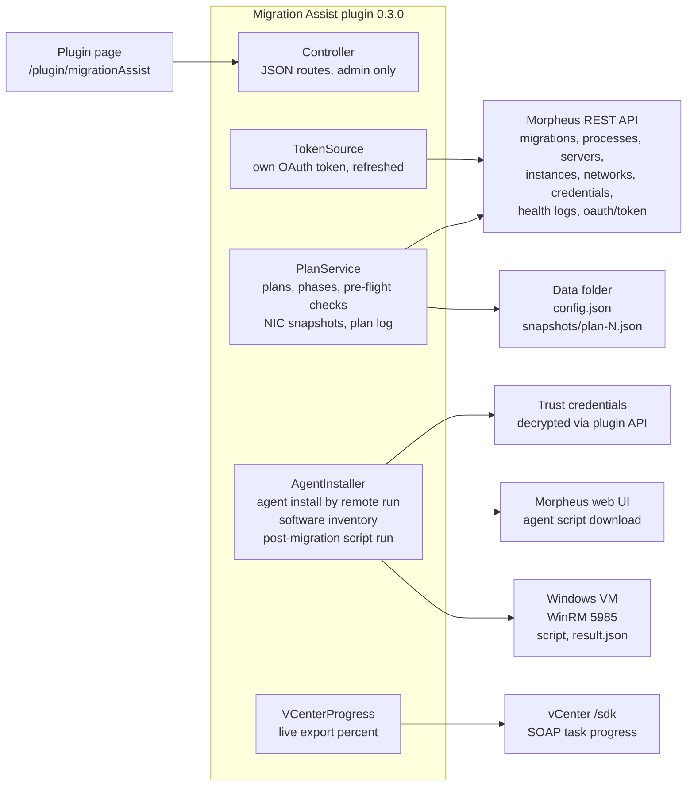

# Migration Assist — VMware to HVM Migration Plugin

Full documentation for Migration Assist 0.3.0 and its guest script `Invoke-VMwareToVirtio.ps1` 1.4.0.

- [Overview](#overview)
- [Architecture](#architecture)
- [Installation and settings](#installation-and-settings)
- [Workflow](#workflow)
- [Pre-flight checks reference](#pre-flight-checks-reference)
- [Invoke-VMwareToVirtio 1.4.0 reference](#invoke-vmwaretovirtio-140-reference)
- [Morpheus API reference](#morpheus-api-reference)
- [Troubleshooting](#troubleshooting)
- [Limitations and roadmap](#limitations-and-roadmap)

## Overview

Migration Assist is a Morpheus plugin that wraps the native VMware → HVM migration plans and finishes the job they leave undone: static IP settings, VMware Tools removal and the full VirtIO guest tools suite. Plugin 0.3.0 and its bundled script have completed a full run end to end on a Morpheus 9.0.2 appliance.

### The problem

The built-in migration keeps each NIC's MAC address, but that only works up to a point for static-IP VMs:

- **Windows** binds IP settings to the adapter's device instance, not its MAC. The new virtio NIC is a new device ("Ethernet 2"), and the old vmxnet3 becomes a hidden ghost adapter still holding the static IP.
- **Morpheus's VirtIO injection** installs only the boot and network drivers. The full guest tools suite (QEMU guest agent, balloon, serial and the rest) is a post-install step.
- **VMware Tools** is left installed on the migrated VM, and its uninstaller often fails (MSI 1603) once the VM is off VMware.
- **The source VM's IPs disappear** from Morpheus as soon as the plan powers it off, so they must be captured while the plan is still pending.

### What it does

| Stage | What Migration Assist does |
| --- | --- |
| Before migration | Snapshots every source NIC (MAC, IP, network), checks DHCP and subnet fit on the destination network, confirms the VM is managed, the agent is healthy and WinRM is reachable, writes a credential profile into the plan, and can install the Morpheus agent itself |
| During migration | Shows the seven migration phases per VM, flags stalled phases, reads live export progress from vCenter, then tracks the new instance's own Provision and Startup processes |
| After migration | Scans for VMware, Broadcom and Omnissa software, runs the post-migration script (full VirtIO set, VMware Tools removal, NIC restore, reboot) and verifies the result |

### Requirements

- Morpheus / VM Essentials 9.0.x (built and tested on 9.0.2; plugin API 1.3.3).
- The vCenter cloud is managed by Morpheus, and the VMs to migrate are managed (instances, not discovered-only).
- The vCenter cloud's RPC mode is VMware Tools (guest exec), with WinRM (5985) reachable from the appliance as the remote-run path.
- A Morpheus service account (Trust credential) for the plugin's own API token and web session.
- A Windows guest credential (Trust credential) that can log in to the VMs over WinRM as a local administrator.
- DHCP on the destination network, so the migrated VM is reachable before its static IP is restored.

### Components

| Component | Version | Role |
| --- | --- | --- |
| Migration Assist plugin (`migrationAssist`) | 0.3.0 | Page at `/plugin/migrationAssist`: plans, pre-flight, credentials, agent install, post-migration run |
| `Invoke-VMwareToVirtio.ps1` | 1.4.0 | Guest-side script, bundled in the plugin; also usable on its own |
| `Start-VMwareToVirtio.ps1` | 1.4.0 | Loader for a Morpheus Remote PowerShell task; downloads the script and checks its SHA-256 pin |
| `Test-VMwareToVirtio.ps1` | 1.4.0 | Offline test suite (170 checks, runs on PowerShell 7 on Windows or Linux) |
| `vme-guest-run.py` | 1.1.0 | Host-side runner over the QEMU guest agent, for VMs WinRM cannot reach |

## Architecture

The plugin runs inside the Morpheus UI process: it reads Morpheus through its own REST API with a self-refreshing token, and reaches the guest over WinRM through the plugin API.

AgentInstaller is the only part that changes a guest; everything else reads. It uses `executeCommandOnServer` with the plan's credential profile, so the VM record's stored login is never involved.

- **Pages and routes.** One page at `/plugin/migrationAssist` calls JSON routes under `/plugin/migrationAssist/api/*`, all requiring the `admin-cm` permission.
- **Token.** TokenSource signs in as the service account (`morph-api` password grant), refreshes the token, retries once on a 401, and backs off 10 minutes after a rejected login.
- **Background work.** A poller snapshots pending plans every 120 s. Agent, inventory and post-migration runs are background jobs the page polls every 4–5 s.
- **Guest transport.** Files go up as base64 chunks of 3,000 characters, are decoded in the guest and checked by SHA-256 there. Every call has a time limit (2 min per step, 15 min for the agent installer). Success is judged by exit codes and markers, because Morpheus's WinRM call may return no output.
- **Post-migration run.** The script runs as a one-shot SYSTEM scheduled task, so restoring the IP cannot end it; the plugin follows the VM to its restored address.

## Installation and settings

Build the plugin, upload the `-all` jar, then set two credentials: a Morpheus service account and a Windows guest login.

### Build and install

1. Build on a machine with JDK 17: `./gradlew shadowJar` (Gradle 8.10.2 wrapper, Shadow 7.1.2, `morpheus-plugin-gradle` 1.3.0, `plugin-api` 1.3.3, Groovy 3.0.13, Java 11 target).
2. Upload `build/libs/migration-assist-0.3.0-all.jar` in Administration › Integrations › Plugins.
3. Open `/plugin/migrationAssist`. The header shows the plugin version, the bundled script version and the API token state.
4. Coming from Migration Prep (`migrationPrep`): remove it first. The plugin code changed, so Morpheus treats Migration Assist as a new plugin and its settings must be entered again. The old `/var/opt/morpheus/morpheus-ui/migration-prep/` folder can be deleted.

### Settings

| Setting | Default | Purpose |
| --- | --- | --- |
| Appliance URL | `https://127.0.0.1` | Where the plugin calls the Morpheus API (the appliance calling itself). The appliance certificate usually does not list 127.0.0.1, so the plugin skips chain and hostname checks for this self-call |
| Service account credential | (empty) | Trust credential ID of a Morpheus user with admin rights. The plugin gets and refreshes its own API token (OAuth `morph-api` password grant) and signs in to the web UI to download agent scripts. Must be a Morpheus login, not a guest login |
| API token (fallback only) | (empty) | Used only when no service credential works. Expires after 30 days by default on 9.0; the header badge turns yellow (`setting`) while it is in use |
| vCenter credential | (empty) | Optional Trust credential for reading vCenter task progress. Empty = the source cloud's own credentials through the plugin API |
| VirtIO installer URL | (empty) | Where migrated VMs download `virtio-win-guest-tools.exe`, e.g. an internal web server. Empty = fedorapeople.org (needs internet) or an attached virtio-win ISO |
| Snapshot poll interval | 120 s | How often pending plans are re-snapshotted |
| Stall threshold | 30 min | A running phase with no update for this long is flagged as stalled |

### Credentials

- **Service account** — use a dedicated Morpheus user. Check it before saving with a password grant against `/oauth/token?grant_type=password&scope=write&client_id=morph-api`; an `access_token` back means it works. A rejected login is not retried for 10 minutes, so the plugin cannot lock the account.
- **Credential profile (guest login)** — a Trust credential (username/password) for the VMs. Assign it to one or more plans from the plans list. It is always saved for the plan's post-migration run, and for pending plans it is also written into the plan's own `windowsUsername`/`windowsPassword` (or the Linux pair).
- **VM record login** — Morpheus's own agent push and guest commands use the login stored on each VM record, not the plan's. **Apply profile to VM login** writes the profile into the record when it is stale.
- Passwords are resolved on the appliance through the plugin API and never sent to the page. `config.json` stores credential references only.

### Data on the appliance

`/var/opt/morpheus/morpheus-ui/migration-assist/`

- `config.json` — credential profile assignments (references only).
- `snapshots/plan-<id>.json` — per-plan NIC snapshots, managed/agent state, login-failure scans, inventory and post-migration results.

## Workflow

Create the plan in Morpheus, leave it pending until Migration Assist shows it clean, run it, and start the post-migration script only when the VM shows **ready for post-migration run**.

### Before migration (plan pending)

1. **Create the migration plan** in Morpheus as usual. Leave it pending.
2. **Assign a credential profile.** Tick the plan, pick the guest Trust credential and the OS, and click Apply. For a pending plan this also sets the plan's own Windows/Linux credentials.
3. **Take the NIC snapshot.** The poller does this automatically for pending plans; **Take NIC snapshot** forces it. Every NIC must show an IP. The snapshot is the only record of the source IPs once the plan runs.
4. **Check connectivity + logins.** Tests WinRM (5985/5986) or SSH (22) from the appliance and scans the last two hours of appliance logs for rejected guest logins against the VM.
5. **Fix what the checks flag.** Use **Apply profile to VM login** for a stale VM record login and **Install agent (remote run)** for a missing agent. Optionally run **Scan VMware/Broadcom software** now: products other than VMware Tools are best uninstalled while the VM is still on VMware.
6. **Run the plan** from Morpheus.

### During migration

- Each VM shows the seven migration phases (Migration preCheck, Preparing Source Workloads, Create Destination Workloads, Transferring Workload, Reconfigure VirtIO Drivers, general, Finalize Migration). The running phase is highlighted with its percent.
- A phase with no update past the stall threshold turns red, and the plan log shows the matching appliance errors.
- While the plan runs, the line under each VM shows vCenter's own task progress (e.g. *Export OVF template 37%*). Morpheus's *Transferring Workload* stays at 0% during the export; vCenter's figure is the real one.
- The page refreshes every 20 seconds while the plan is running.

### After migration

1. **Wait for the instance.** The plan reports complete at *Finalize Migration*, but Morpheus then runs the new instance's own Provision (ending in *Finalizing*) and Startup processes. The VM shows **instance still provisioning** until they finish, then **ready for post-migration run**.
2. **Scan VMware/Broadcom software** on the migrated VM. Products are listed as VMware Tools, other (checkbox) or protected (report only).
3. **Pick the removal scope** — VMware Tools only (default), Tools plus ticked products, or everything VMware-published.
4. **Run post-migration script.** The job log under the VM shows each step:
    1. Uploads the script, `nic-map.json` (from the snapshot) and `run-config.json`, each hash-checked in the guest.
    2. Starts the script as a one-shot SYSTEM scheduled task, so the IP change cannot cut it off.
    3. Polls for `result.json`. When the DHCP address stops answering and a snapshot IP has 5985 open, it points the server record there.
    4. Waits for the scheduled reboot (60 s after the script ends).
    5. Final check: VMTools service gone, QEMU guest agent present, WinRM answering.
5. **Review the result** — the VM shows the last run's status badge; details are in `C:\ProgramData\VMwareToVirtio\` on the VM (`result.json`, `run-*.log`).

## Pre-flight checks reference

Every check shows as **ok**, **info**, **warn** or **bad** on the VM or its NIC; a pending plan should have no **bad** lines before it runs.

| Check | Level | Meaning | Fix |
| --- | --- | --- | --- |
| No NIC snapshot | warn (pending) / bad (ran) | Source IPs were not captured; after the run they are gone from Morpheus | Take NIC snapshot while pending; after a run, MAC and network are recovered from the migrated VM but not the old IP |
| NIC has no IP | warn | VMware Tools is not reporting this NIC's IP, so the script cannot place it by IP | Start VMware Tools on the source, snapshot again |
| Network not mapped | bad | The NIC's source network has no mapping in the plan | Edit the plan's network mapping |
| DHCP on | ok | The migrated VM gets a lease, so the remote run can reach it | — |
| DHCP off, static NIC | warn | No address until the script restores it; WinRM cannot reach the VM | Enable DHCP or a temporary pool, or use `vme-guest-run.py` over the QEMU guest agent |
| DHCP off, DHCP NIC | bad | The VM comes up with no address | Enable DHCP on the destination network |
| IP outside CIDR | bad | The plan maps the NIC to the wrong VLAN | Fix the plan mapping |
| No CIDR on network | info | Subnet-fit check skipped | Fill in CIDR and gateway on the HVM network |
| Managed by Morpheus | ok / bad | The VM is an instance, or only discovered (e.g. `vmwareUnmanaged`) | Convert to managed (Actions › Make Managed) |
| Morpheus agent | ok / warn | Installed and checked in, not installed, or silent for 15+ minutes | Install agent (remote run) |
| Guest login rejected | bad | Appliance logs show WinRM or VMware Tools logins rejected for this VM; unnamed `InvalidGuestLogin` lines are tied to the VM by worker thread | Apply profile to VM login |
| VM record login differs | info | The record's login user differs from the plan's | Apply profile to VM login if the record is wrong |
| No Windows/Linux credentials | warn | The plan has no guest credentials | Assign a credential profile |
| Ports | bad | No 5985/5986/22 reachable from the appliance | Firewall, WinRM service, network profile; 5986 closed is normal |
| Phase stalled | bad | A running phase has not updated past the threshold | Check the plan log and the HVM hosts' storage pools |
| Phase failed | bad | A migration phase failed | See the phase error |
| Instance still provisioning | info | Morpheus is still running Provision/Startup on the new instance | Wait; the page refreshes itself |
| Instance provision failed | bad | The new instance's Provision process failed | Operations › Activity › History for the instance |

## Invoke-VMwareToVirtio 1.4.0 reference

The script runs on the migrated Windows VM as an administrator (or SYSTEM), works out of `C:\ProgramData\VMwareToVirtio`, and writes `result.json` on every exit path. On VMware hardware it only captures the NICs (`nic-premigration.json`) and exits, unless `$Force` is set.

### Phases

| Phase | What it does |
| --- | --- |
| 0. Pre-flight | Relaunches 64-bit if needed; requires FullLanguage mode, elevation and PowerShell 4+; reads `run-config.json`; inventories VMware/Broadcom/Omnissa software; `Mode=Inventory` exits here; loads `nic-map.json` and any pre-migration capture |
| 1. VirtIO | Inventories VirtIO devices and drivers; installs `virtio-win-guest-tools.exe` when anything is missing (work folder first, then `$VirtioSource`, an attached ISO, then download); checks the Red Hat signature; uses `/repair` for the same bundle version |
| 2. VMware Tools | Skipped when Phase 1 left gaps. Otherwise: uninstalls ticked products (Selected), runs the Tools MSI uninstall, saves a network snapshot, captures ghost NIC settings and removes ghost devices, removes Tools services, filters, driver packages, files and registry keys per the scope |
| 3. NIC restore | Places each captured config on a virtio NIC: pre-migration GUID, then the NIC map's MAC, then device-ID decode, then a gateway probe for multi-NIC VMs; verifies with DAD and a gateway ping and rolls back to DHCP on failure; frees the ghost's connection name and renames the new NIC to the old name |
| 4. Wrap-up | Summary, `result.json`, reboot 60 s later when needed |

### Removal scopes

| Scope | Removes | Leaves in place |
| --- | --- | --- |
| ToolsOnly (default) | VMware Tools: its services, Tools-owned drivers (vmxnet3, pvscsi, vmci, vsock, vmmouse, vmmemctl, vm3d, vmhgfs and others), `Program Files\VMware\VMware Tools`, the Tools CAF/VGAuth/Drivers folders and the Tools registry subkeys | Every other VMware, Broadcom or Omnissa product, logged as "left in place"; parent folders and `VMware, Inc.` kept unless empty |
| Selected | ToolsOnly plus the products in `RemoveProducts`, through their own uninstallers | Protected products (Carbon Black and similar) are never uninstalled |
| AllVMware | The 1.3.0 behaviour: everything VMware- or Broadcom-published, whole `VMware` folders and the whole `VMware, Inc.` key (Broadcom KB 315629) | Nothing VMware-published |

Products are better uninstalled before migration: Horizon and similar installers may refuse once the hardware changes, as the Tools MSI does with 1603.

### Files in the work folder

| File | Written by | Content |
| --- | --- | --- |
| `run-config.json` | Migration Assist | Overrides: `Mode`, `RemoveScope`, `RemoveProducts`, `VirtioSource`, `RebootWhenDone`, `SetPrivateProfile`, `ApplyNicConfig`, `ForceVirtioInstall`, `SkipRemovalIfVirtioFailed` |
| `nic-map.json` | Migration Assist / `vme-guest-run.py` | `[{"MacAddress","IPAddress","Name","Source"}]` from the pre-migration snapshot |
| `nic-premigration.json` | the script on VMware | Optional pre-migration capture with interface GUIDs |
| `nic-capture.json` | the script | Ghost NIC settings, reused on a re-run |
| `result.json` | the script | `version`, `mode`, `status` (`ok`, `attention`, `pending-reboot`), `failures`, `virtioGaps`, `vmwareToolsRemoved`, `removalSkipped`, `removed` counts, `nics`, `leftInPlace`, `products`, `reboot` |
| `run-<stamp>.log` | the script | Full log |
| `virtio-win-guest-tools.exe` | optional upload | Used first when present (1 MB or larger) |

### Script settings

The settings sit at the top of the script and can be overridden by `run-config.json`.

| Setting | Default | Effect |
| --- | --- | --- |
| `$Mode` | `Run` | `Inventory` lists vendor software to `result.json` and exits |
| `$RemoveScope` | `ToolsOnly` | `ToolsOnly`, `Selected` or `AllVMware` |
| `$RemoveProducts` | empty | Uninstall entry names or product codes for `Selected` |
| `$SkipRemovalIfVirtioFailed` | `$true` | Leave VMware Tools alone when Phase 1 failed |
| `$VirtioSource` | empty | Path, folder or URL of the installer |
| `$VirtioCheckOnly` | `$false` | Report VirtIO and Tools state, change nothing |
| `$RemoveGhostDevices` | `$true` | Remove non-present VMware devices and PCI NICs |
| `$ApplyNicConfig` | `$true` | Put the old static settings on the matching virtio NIC |
| `$ProbeUnmatchedNics` | `$true` | Gateway probe for multi-NIC VMs with no MAC match |
| `$RollbackIfUnreachable` | `$true` | Revert a NIC to DHCP on duplicate address or no gateway |
| `$RebootWhenDone` | `$true` | Schedule a reboot `$RebootDelaySeconds` (60) after the run |
| `$SetPrivateProfile` | `$false` | Workgroup VMs: Public NICs to Private and the WinRM HTTP rule on |

### Running it outside the plugin

- **Morpheus task**: PowerShell, Execute Target **Remote**, host and credentials in the task, Elevated Shell unticked; body = `Start-VMwareToVirtio.ps1`, which downloads the script from your web server and checks the SHA-256 pin `F54C149E1EB962C617D145E9FDFD38E3EB6AA1017D2783FC7C327CEF0AE0F825` before running it.
- **QEMU guest agent**: `vme-guest-run.py <domain> --nic-map <file> --wait-reboot` on the HVM host; no network or WinRM needed.
- **Tests**: `pwsh -File Test-VMwareToVirtio.ps1` next to the script (170 checks).

## Morpheus API reference

Everything below was called against a Morpheus 9.0.2 appliance unless marked otherwise; field names come from live responses.

### REST endpoints

| Endpoint | Used for | Notes |
| --- | --- | --- |
| `GET /api/migrations[/{id}]` | Plans, VMs, network mappings, plan credentials | Keys: `servers[{sourceServer, destinationServer, status, statusMessage}]`, `networks[{sourceNetwork, destinationNetwork}]`, `windowsUsername`, `windowsPassword` (masked), `linuxUsername`, `linuxPassword`, `linuxKeyPair`, `installGuestTools`, `skipPrechecks`, `reInitializeServerOnMigration`, `sourceCloud`, `targetCloud`, `targetGroup`, `targetPool`, `datastores` |
| `PUT /api/migrations/{id}` | Write plan credentials | Body `{"migration":{"windowsUsername","windowsPassword"}}`; pending plans only |
| `POST /api/migrations/{id}/run` | Run a plan | From morpheus-cli; not used by the plugin yet |
| `GET /api/processes?refType=migrationPlan&refId={id}` | Phase progress | One process per run; `events[]` carry `processType.name`, `status`, `percent`, `displayName` (VM name), `lastUpdated`, `error`, `output`. Plan-level `percent` stays 0 |
| `GET /api/instances/{id}/history` | New instance's Provision / Startup | Same process shape |
| `GET /api/servers/{id}` | NICs, managed state, agent, VM login | `interfaces[{macAddress, ipAddress, network{id,name}}]`; source `ipAddress` goes null once the plan powers the VM off; `agentInstalled`, `agentVersion`, `lastAgentUpdate`, `sshUsername` |
| `PUT /api/servers/{id}` | VM record login and address | `{"server":{"sshUsername","sshPassword"}}`; `{"server":{"sshHost","internalIp"}}` |
| `PUT /api/servers/{id}/upgrade` | Morpheus agent push | Uses the VM record's login (VMware Tools guest exec, then WinRM) |
| `PUT /api/servers/{id}/install-agent` | Make Managed | `server{sshUsername, sshPassword, serverOs{id}}`; from morpheus-cli, not used yet |
| `GET /api/networks/{id}` | Destination network facts | `dhcpServer`, `cidr`, `gateway`, `dnsPrimary`, `vlanId` |
| `GET /api/zones/{id}` | vCenter URL | `config.apiUrl`, `config.username`; password masked |
| `GET /api/credentials` | Credential picker | `credentials[{id, name, type{code,name}, username}]` |
| `GET /api/health/logs` | Plan log, login-failure scan | Params `level` (`WARN%7CERROR` — the pipe must be URL-encoded or Tomcat returns a 400 page), `startDate`, `endDate`, `max`, `offset`; rows `ts`, `level`, `message`, `hostname`, `objectId`, `sourceType`, `title`, `seq`; newest first; `ts` uses `+0000` |
| `POST /oauth/token?client_id=morph-api&grant_type=password&scope=write` | Plugin API token | Refresh with `grant_type=refresh_token` |

### UI routes (web session required)

- `GET /login/auth`, then `POST /login/process` with `_csrf` — sign-in; success sets `JSESSIONID`.
- `GET /infrastructure/servers/{id}/download-agent-script` — the VM-specific agent installer (PowerShell, about 2.5 KB, carries the VM's API key). An API token is not accepted here.

### Plugin API (1.3.3)

- `morpheus.services.accountCredential.loadCredentialConfig([type: <credential id>], [:])` — decrypted credential; values under `.data`. `[type:'local', …]` means inline form values and returns nothing for a stored credential.
- `morpheus.executeCommandOnServer(server, cmd, rpc=true, user, pass, …)` — WinRM with explicit credentials, the same path as a Remote PowerShell task. It may return no output; the plugin relies on exit codes and markers.
- `morpheus.services.computeServer.get(id)`, `morpheus.services.cloud.get(id)`.
- `DataQuery` has no `withMax()`; set the public field `max` instead.

### vCenter SOAP (`/sdk`)

`RetrieveServiceContent` → `Login` → `RetrievePropertiesEx` on `TaskManager.recentTask` → `RetrievePropertiesEx` on each `Task.info` (`entityName`, `descriptionId`, `state`, `progress`) → `Logout`. Morpheus migrates with `migrateOvfToHvm`, which shows in vCenter as *Export OVF template*. Tested against a simulated vCenter only.

## Troubleshooting

Each entry came up during testing; the symptom is what you see, the fix is what resolved it.

| Symptom | Cause | Fix |
| --- | --- | --- |
| Header: `password grant HTTP 400 … invalid_grant` | The service credential is not a Morpheus login (e.g. the Windows guest credential) | Point the setting at a Morpheus user's Trust credential; test it with the `/oauth/token` call first |
| Header: `certificate_unknown` / no SAN for 127.0.0.1 | The appliance certificate does not list 127.0.0.1 | Fixed in 0.1.1 (the plugin skips the hostname check for its self-calls) |
| `Unknown User Login Attempt` for a user from the appliance's own IP | A plugin retrying a bad stored login | Fix the credential; Migration Assist backs off 10 minutes after a rejection |
| Morpheus agent upgrade fails: `Authorization loop detected`, `WinRMAuthorizationError`, `InvalidGuestLogin` | The VM record's stored login is wrong; Morpheus uses it for both WinRM and VMware Tools | Apply profile to VM login, or Install agent (remote run), which uses the plan's profile |
| Agent install job: `upload corrupted … guest null` | Morpheus's WinRM call returned no output | Fixed in 0.2.6 (hash checked inside the guest, exit codes instead of output) |
| Agent reinstall looks stuck | The installer restarts the agent service and the remote call waits | Every call now has a time limit (2 min upload steps, 15 min installer); the job waits for a new agent check-in |
| Plan stuck at *Create Destination Workloads* 0% for hours | An HVM host's `morpheus-images` storage pool is inactive (its folder missing); the appliance log shows `error loading storage pool list … KvmComputeUtility._()` every 2–3 minutes | `virsh pool-build morpheus-images && virsh pool-start morpheus-images` on the host; cancel and recreate the plan, and power the source VM back on |
| *Transferring Workload* stays at 0% | Morpheus does not update that event during the OVF export | Read vCenter's progress under the VM (0.2.7+) |
| VM marked ready while the new instance is still *Finalizing* | The plan completes before the instance's own Provision process | Fixed in 0.2.8 (readiness waits for the instance's Provision and Startup) |
| `VirtIO driver install attempt 1 failed on server …: null` | Morpheus's VirtIO injection retries during Preparing Source Workloads | No action if *Reconfigure VirtIO Drivers* completes; the post-migration script checks the drivers anyway |
| `GET /api/health/logs` returns a non-JSON error page | Unencoded pipe in `level=WARN\|ERROR` | Encode it as `%7C` |
| Port 5986 closed | No HTTPS WinRM listener (Windows default) | Expected; the plugin uses 5985 |
| Several versions of the same plugin in `/var/opt/morpheus/morpheus-ui/plugins/` | Old jars left behind after upgrades | Check the active version in Administration › Integrations › Plugins and remove the rest |

## Limitations and roadmap

Windows VMs on a DHCP-enabled destination network are covered end to end; Linux and DHCP-less networks are not yet.

### Limitations

- **Windows only.** No Linux path yet: open-vm-tools removal, virtio modules in the initramfs, re-binding netplan/nmcli to the new interface name.
- **Needs DHCP after migration** for the WinRM run. VMs on DHCP-less networks need `vme-guest-run.py` over the QEMU guest agent, or a temporary pool.
- **Captured network settings are IPv4 only**: IPs, masks, gateways, DNS servers and suffix. NetBIOS/WINS, DNS registration flags, interface metrics and static IPv6 are not restored.
- **VirtIO installer download** needs internet, the VirtIO installer URL setting, or an attached ISO. The installer (~30 MB) is too large to push over chunked WinRM.
- **WinRM output.** Morpheus's remote call may return no output; the plugin then reports status through exit codes and the inventory list cannot be shown.
- **No leader election.** On an HA appliance cluster, more than one node could run the snapshot poller.
- **The plugin does not start plans.** Plans are run from Morpheus; Migration Assist checks and follows them.

### Verified on a live appliance (Morpheus 9.0.2)

- Plan, process, network, server, credential and log fields.
- OAuth service-account token, credential decryption by ID, plan credential `PUT`.
- Pre-migration snapshot surviving cutover; managed and agent checks.
- Agent install by remote run on a Windows Server 2022 VM.
- Post-migration run on the migrated Windows Server 2022 VM, final stage confirmed.

### Tested only with simulated data

- vCenter task progress (SOAP) against a real vCenter.
- Server address switch (`PUT /api/servers` with `sshHost`/`internalIp`) after the IP change.
- `Selected` and `AllVMware` scopes on a VM with other VMware products installed.

### Roadmap

- [ ] Linux post-migration script and SSH remote run
- [ ] Restore NetBIOS/WINS, DNS registration and IPv6 settings
- [ ] Check the vCenter cloud's RPC mode is VMware Tools (pre-flight)
- [ ] Make Managed action through `/api/servers/{id}/install-agent`
- [ ] Pre-flight fix actions over VMware Tools guest exec (start WinRM, widen the firewall rule)
- [ ] Rename the migrated VM's Morpheus record (server and instance)
- [ ] Leader election for HA appliances
- [ ] Run plans from the plugin, gated on a clean pre-flight
